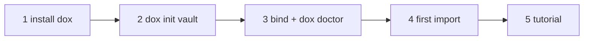

# Agents in this repository

This checkout is the Doxagon **platform**: code, the `dox` CLI and packaged
skills. It holds no user knowledge. That lives in a **vault** the user owns.

- The user wants to *use* Doxagon (first run, "set me up", no vault yet):
  follow **Onboarding** below.
- You are changing the platform itself: see **Development**.

## Onboarding

1. **Install the CLI** from this checkout, so updates are a `git pull`:
   `uv tool install --editable .` (or `pipx install -e .`). Confirm with
   `command -v dox`. If uv warns that its bin directory is not on PATH, tell
   the user and offer `uv tool update-shell`.
2. **Create the vault.** Ask where it should live (suggest `~/doxagon-vault`),
   then `dox init <path>`. This writes the vault layout, a starting
   `knowledge/schema.yaml`, `AGENTS.md`/`CLAUDE.md`, and installs the packaged
   skills into `<path>/.pi/skills` (also linked as `<path>/.claude/skills`).
   Offer to make the vault a private git repository; never put it inside this
   checkout.
3. **Bind and check.** `export DOXAGON_ROOT=<path>`, and offer to add that line
   to the user's shell profile. Run `dox doctor` and act on every `fix:` line.
   `entry_point`, `vault_binding`, `skills`, `agents_md` and `path_shims` must
   pass; `provider` and `frontend` matter only for images and the web UI. A
   failing `path_shims` means an older `dox` on PATH: ask before removing it.
   If the user wants images, follow
   [`image-provider`](./src/doxagon/resources/skills/image-provider/SKILL.md).
4. **First import.** Follow
   [`dox-knowledge`](./src/doxagon/resources/skills/dox-knowledge/SKILL.md):
   ask for one to three sources, admit each with `dox phantasia add`, and
   extract with `dox extract --context` / `--response`. You are the judge; the
   CLI calls no model and needs no API key.
5. **Tutorial.** Follow
   [`doxagon-onboarding`](./src/doxagon/resources/skills/doxagon-onboarding/SKILL.md):
   a pipeline diagram, the user's own graph via `dox graph`, and a
   what-to-do-next table.

After onboarding, work from the vault: its `AGENTS.md` and skills take over.

## Development

- Tests run without a vault: `uv run --extra dev pytest -q`.
- Work on a branch and land by pull request.
- New public files must be listed in `publication/platform-files.yaml`;
  `uv run python scripts/build_platform_tree.py --check` enforces it.
- Packaged skills live in `src/doxagon/resources/skills/`; `dox skills sync`
  copies them into a vault.
