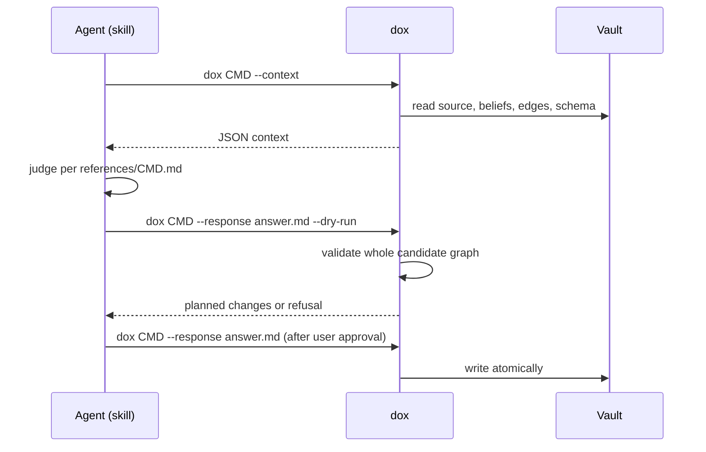

# Knowledge-work architecture

**BLUF:** The platform calls no model. Every command that needs judgment
(extraction, integration and audit) is split in two: `dox` emits structured
context and validates the answer, and the `dox-knowledge` skill holds the
judgment. Whatever agent the user runs is the judge.

## Commands

| Command | `--context` emits | `--response` accepts | Writes |
|---|---|---|---|
| `dox extract <p-slug>` | source text, existing beliefs, edge types, domains | `DOXA`, `EVIDENCE`, `EDGES`, `DUPLICATE` blocks | doxai, evidence, edges; marks the phantasia processed |
| `dox integrate` | cluster list; with `--cluster N\|all\|cross`, one unit of beliefs and edges | `EDGE` blocks | new edges |
| `dox audit` | a page of edges with both endpoint beliefs | `AUDIT` blocks | type corrections, rationales, aliases, confidence |

The skill's references (`src/doxagon/resources/skills/dox-knowledge/references/`)
define the judgment rules and the exact block formats.

## Validation before write

`--response` builds the complete candidate graph and refuses the whole answer
on any error: an invalid block, an unregistered edge type or domain tag, an
endpoint that is not a doxa, a duplicate edge identity, or an audit verdict
naming an edge that does not exist. `--dry-run` reports the planned change and
writes nothing. Partial writes are impossible by construction.

## Units of work

Contexts are sized for one agent: one phantasia, one cluster
(`detect_clusters`, Louvain), or one page of edges. That is also the unit a
host agent may delegate to a sub-agent.

## Deduplication

There is no separate dedup model call. The extraction context lists every
existing belief; the judge reports duplicates as `DUPLICATE` blocks and links
related claims with edges.
