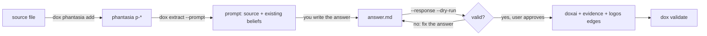

# Knowledge intake

You are the extractor. `dox` prepares the context and validates your answer;
it never calls a model on this path.

## Steps

1. `dox doctor`; fix failures before writing.
2. **Get text.** `dox phantasia add` takes UTF-8 Markdown or text. Fetch URLs
   and convert PDFs, slides or transcripts to Markdown yourself first. Keep the
   original location for `--source`.
3. **Admit it.**
   `dox phantasia add source.md --title "..." --source "<url or citation>" --channel article`
4. **Read the prompt.** `dox extract <p-slug> --prompt > /tmp/<p-slug>.prompt.md`,
   then read all of it. It holds the source, every existing belief, the edge
   vocabulary and the exact output format.
5. **Write the answer** to a file in that format: `===DOXA===`,
   `===EVIDENCE===`, `===EDGES===`, `===DUPLICATE===` blocks. Rules below.
6. **Check it.** `dox extract <p-slug> --response answer.md --dry-run`. Nothing
   is written if any edge, endpoint or domain tag is invalid. Fix the answer and
   repeat until it passes.
7. **Show the user** the planned beliefs, evidence and edges, and get approval
   before writing. Then run the same command without `--dry-run`.
8. **Cite evidence.** Evidence slugs are assigned at write time, so add each
   new `e-*` slug to the `evidence:` list of the doxai it supports.
9. `dox validate`, then report what was created by slug.

## Answer rules

| Rule | Why |
|---|---|
| Every doxa is a claim the source makes or directly implies; no outside knowledge | the graph records what this source supports, not what you know |
| One atomic, falsifiable claim per doxa; split compound claims | edges and evidence attach to single claims |
| Evidence quotes the source verbatim and cites only what the source cites | an invented citation is worse than none |
| A claim already in EXISTING BELIEFS becomes a `===DUPLICATE===` naming its slug, not a new doxa | dedup is your job on this path |
| New doxai are `NEW:n` in edges; existing ones use their exact `d-*` slug | slugs are assigned at write time |
| Edge types come only from `knowledge/schema.yaml` `edge_types`; every rationale says *why* | unregistered types are refused |
| `domain:` tags must be registered in `tag_prefixes.domain.values`; ask before adding one, or omit the tag | domains are controlled vocabulary |
| `status: draft` on every new doxa | the user, not the extractor, promotes a belief to `canonical` |

Scale the count to the source: a page of notes yields a handful of doxai, a
long report dozens. On a first import, prefer 3–8 strong beliefs over
exhaustive coverage.

## After writing

- `dox list`, `dox show <slug>`, `dox related <slug>`: inspect results.
- `dox graph` prints the graph as Mermaid; `dox graph --root <slug>` scopes it.
- `dox link` / `dox unlink`: adjust edges; both validate the whole edge set.
- Promotion is a frontmatter edit: `status: draft` → `canonical` once the user
  endorses the belief.

`dox extract --gemini` is an optional fallback that lets the Gemini CLI answer
instead; it needs `gemini` on PATH and is not required for anything here.
