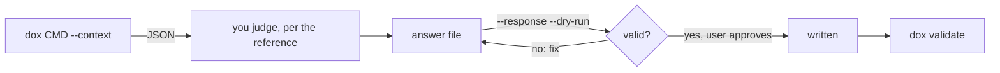

# Knowledge work

`dox` gathers data and validates. You judge. No step calls a model on your
behalf.

| Task | Context | Judgment and answer format |
|---|---|---|
| Import a source and extract beliefs | `dox extract <p-slug> --context` | [references/extract.md](./references/extract.md) |
| Find missing edges, tensions, gaps | `dox integrate --context [--cluster N\|all\|cross]` | [references/integrate.md](./references/integrate.md) |
| Confirm or correct edge types | `dox audit --context [--offset N --limit M]` | [references/audit.md](./references/audit.md) |

Read the reference before you judge; it holds the rules and the exact block
format `--response` accepts.

## Every task

1. Run `dox doctor` and fix any failures before writing.
2. Get the context, read all of it, and write your answer to a file.
3. `dox <cmd> ... --response answer.md --dry-run`. Nothing is written while
   any block, edge, endpoint or domain tag is invalid. Fix the answer and
   repeat until it passes.
4. Show the user what will change, and get approval before writing.
5. Run the same command without `--dry-run`, then `dox validate`, then report
   what changed by slug.

## Importing a source

1. **Get text.** `dox phantasia add` takes UTF-8 Markdown or plain text.
   Fetch URLs and convert PDFs, slides or transcripts to Markdown yourself. If
   a fetch fails or returns something other than the source, say so and ask
   for the text; never write a source from memory.
2. **Admit it:** `dox phantasia add source.md --title "..." --source "<url or
   citation>" --channel <kind>`.
3. Extract it per [references/extract.md](./references/extract.md), then run
   the steps above.
4. **Cite evidence.** Slugs are assigned at write time, so after applying, add
   each new `e-*` slug to the `evidence:` list of the doxai it supports.

## Rules that hold everywhere

| Rule | Why |
|---|---|
| Claims, quotes and citations come only from the material in front of you | the graph records what sources support, not what you know |
| Edge types only from the context's `edge_types` | unregistered types are refused |
| `domain:` tags only from the context's `domains`; ask before registering a new one in `knowledge/schema.yaml` `tag_prefixes.domain.values` | domains are a controlled vocabulary |
| New doxai are `status: draft` | the user, not the judge, promotes a belief to `canonical` |
| Leave out `source_url` when the source has none | an empty or made-up URL reads as a citation |

## Afterwards

- `dox list`, `dox show <slug>`, `dox related <slug>`: inspect the result.
- `dox graph` prints Mermaid; `dox graph --root <slug>` scopes it.
- `dox link` / `dox unlink`: adjust single edges; both validate the whole set.
- Promotion is a frontmatter edit: `status: draft` → `canonical`.
