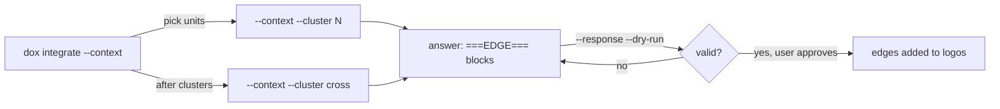

# Integration: judgment and answer format

Goal: find relationships between beliefs that *should* exist but don't. You
also report tensions, evidence gaps and narrative clusters to the user, but
only edges are written.



## Choosing units

`dox integrate --context` lists clusters with their size, how many beliefs
were added this month, and a sample of each.

| Graph | Units |
|---|---|
| a few dozen beliefs | `--cluster all`, one pass |
| larger | one pass per cluster, then one `--cluster cross` pass for bridges |
| the user just imported something | the clusters with the most beliefs added this month |

Each cluster context holds full belief bodies and every edge that touches the
cluster. The `cross` context holds every belief statement labelled with its
cluster, plus all edges. In a cross pass, propose only edges that link
different clusters, and look hardest for non-obvious cross-domain links.

## What to look for

| Finding | Look for | Goes to |
|---|---|---|
| **Missing edge** | cross-domain connections; implicit dependencies (one belief assumes another); support; elaboration | `===EDGE===` blocks |
| **Tension** | direct contradictions, incompatible implications, beliefs that cannot both hold in one context; not trivial differences | your reply to the user, with resolution options |
| **Evidence gap** | claims with no evidence, or claims resting on prerequisites the graph does not establish; say what research would fill it | your reply |
| **Cluster opportunity** | beliefs that together form a coherent argument, premises to conclusion, rather than merely sharing a topic | your reply, as a possible diegesis |

Propose every plausible edge, including moderate-confidence ones: the user
prunes, but cannot review an edge you never surfaced. Sparse regions deserve
more proposals. Do not repeat an edge that already exists.

Use the edge-type distinctions in [extract.md](./extract.md#choosing-edge-types):
`contradicts` only for real conflict, `resolves` when one belief solves
another's problem. A real contradiction you find is a tension to report, and
it is also a `contradicts` edge to propose.

## Answer format

One block per proposed edge. Both endpoints must be existing `d-*` slugs.

```
===EDGE===
source: d-source-slug
target: d-target-slug
type: supports
strength: moderate
confidence: medium
alias: provides evidence for
rationale: |
  Why the source supports the target: the logical connection, not a
  description of either belief.
===END_EDGE===
```

`source`, `target`, `type` and `rationale` are required. `strength` is
strong, moderate or weak; `confidence` is high, medium or low; `alias` is an
optional 2–5 word label. Edges already in the graph are skipped and reported.
Any invalid block refuses the whole answer.
