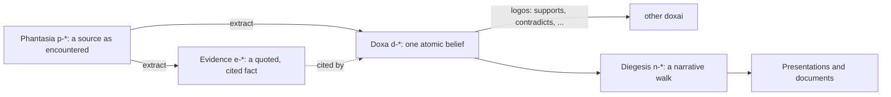

# Onboarding

Goal: the user leaves with their own first beliefs in the graph and a picture
of how they got there. Keep it short; this is a tour, not a manual.

## 1. Check the setup

Run `dox doctor`. `entry_point`, `vault_binding`, `skills` and `agents_md` must
pass. `provider` (image generation) and `frontend` (web UI) are needed only for
presentations and the web workspace, so mention them and move on. Act on any
`fix:` line doctor prints.

## 2. First import

Ask the user for one to three sources they care about: a file, a URL, or notes
pasted into chat (save pasted notes to a `.md` file first). Then follow the
`dox-knowledge` skill for each one. Keep the first extraction small (3–8
beliefs) so the tutorial stays readable.

## 3. Tutorial

Give it after the first import, in this order, in under a screen of text.

**a. The pipeline.** Show this diagram and say one sentence per stage:

| Stage | In their vault |
|---|---|
| Phantasia | `knowledge/phantasiai/` — what they read, unjudged |
| Doxa | `knowledge/doxai/` — one claim per file, `status: draft` until they endorse it |
| Evidence | `knowledge/evidence/` — what a claim rests on |
| Logos | `knowledge/logos.yaml` — typed edges, validated against `knowledge/schema.yaml` |
| Diegesis | `knowledge/diegeses/` — an argument walked through the graph |

A katalepsis is a claim grasped but not yet believed. In practice that is a
`draft` doxa. Assent is promoting it to `canonical`.

**b. Their graph.** Run `dox graph` and show its Mermaid output. Then trace
one real path: name the phantasia they imported, one doxa it produced, the
evidence behind it, and one edge with its rationale. Use their slugs, not
these placeholders.

**c. What to do next.** End with this table:

| To | Run |
|---|---|
| Add another source | `dox phantasia add FILE` then the `dox-knowledge` flow |
| Jot a belief directly | `dox capture "statement"` |
| See what you believe | `dox list`, `dox show <slug>`, `dox overview` |
| Connect two beliefs | `dox link <source> <target> <type>` |
| Find tension | `dox related <slug>`, `dox path <a> <b>` |
| Check integrity | `dox validate` |

Mention once that the vault is plain Markdown and worth keeping in a private
git repository, then stop and let the user drive.
