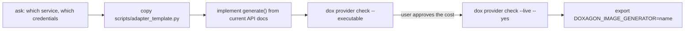

# Image provider

Doxagon builds image prompts and reference bundles but contains no image
model. It runs one executable, the **adapter**, named by
`DOXAGON_IMAGE_GENERATOR`, under the contract in the platform's
`docs/image-providers.md`. This skill writes and verifies that adapter. Assume
no vendor: the user's choice decides.

## Steps

1. **Ask which image service the user can use** and how they authenticate (API
   key, cloud login, local server). If they don't know, list the options their
   machine already shows signs of (installed CLIs, a running local server, keys
   in `~/.doxagon/providers/`). Never print a credential's value, and suggest
   rather than pick.
2. **Start from the template.** Copy
   [scripts/adapter_template.py](./scripts/adapter_template.py) to
   `~/.doxagon/providers/<name>` and `chmod +x` it. It already implements the
   contract: arguments, `--capabilities`, refusal of unsupported sizes, aspect
   ratios and reference counts, and output into `--output`. Keep the adapter
   outside every repository and vault.
3. **Implement `generate()`** against the provider's *current* documentation.
   Look it up; do not rely on remembered model names or endpoints.
   - Send the prompt file's bytes unchanged. If the API rewrites the text,
     detect it and fail rather than repair it.
   - Pass references in the given order and honor size and aspect ratio
     exactly, or exit nonzero.
   - Set `CAPABILITIES` to what the provider really supports, including the
     `model` id.
4. **Credentials** go in `~/.doxagon/providers/<name>.env` (`KEY=value` lines,
   mode 600), loaded by the template. Ask the user to paste secrets into that
   file themselves rather than into chat.
5. **Verify for free:** `dox provider check --executable <name>` checks the
   executable bit, digest and capabilities schema. Fix anything it reports.
6. **Verify for real, with consent.** `dox provider check --executable <name>
   --live --yes` makes one generation call, which may cost money. Ask first.
7. **Select it:** `export DOXAGON_IMAGE_GENERATOR=<name>`; a bare name resolves
   in `~/.doxagon/providers/` before PATH. Offer to add the line to the user's
   shell profile. Then `dox doctor` should show `provider: ok`.

To exercise the contract without any service, the template with a `generate()`
that writes a placeholder PNG passes the free check; it is a test double, not
a provider.

## Rules

| Rule | Why |
|---|---|
| The adapter never translates, retries, fans out or picks among candidates | those change the request the platform hashed and recorded |
| Diagnostics go to stderr, at most a few hundred bytes, with no secrets, signed URLs or prompt contents that contain them | the platform keeps the last 400 bytes of failure output |
| Switching services means a new adapter name, not editing the old one in place | earlier receipts name the adapter's digest |
